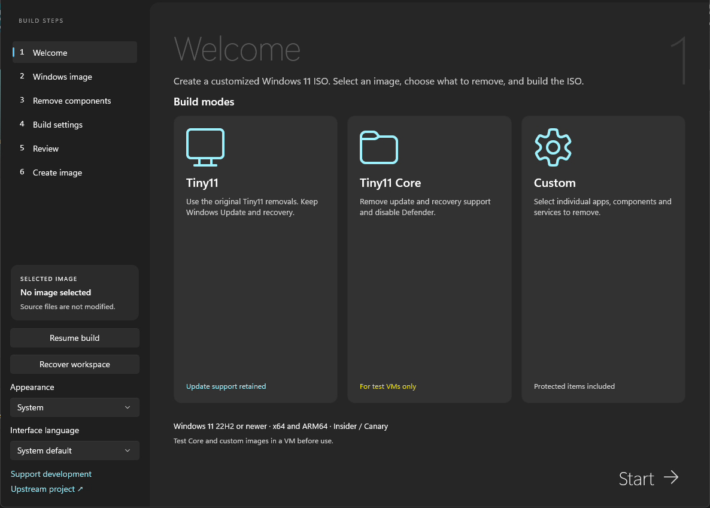
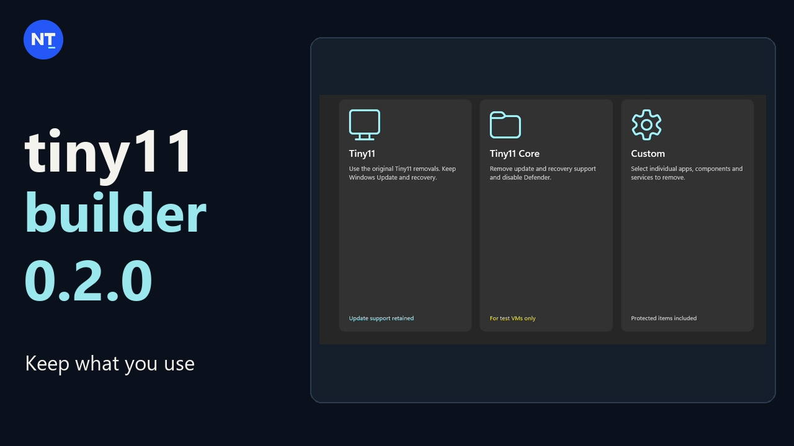
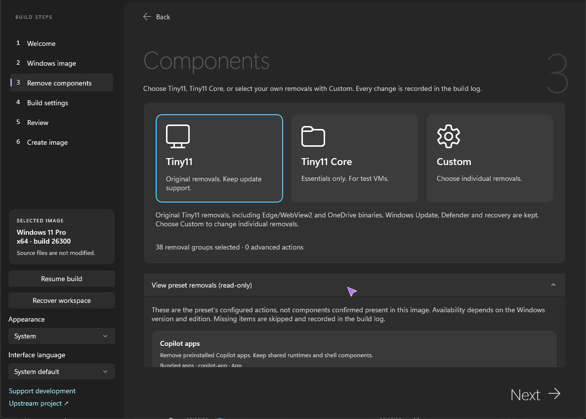
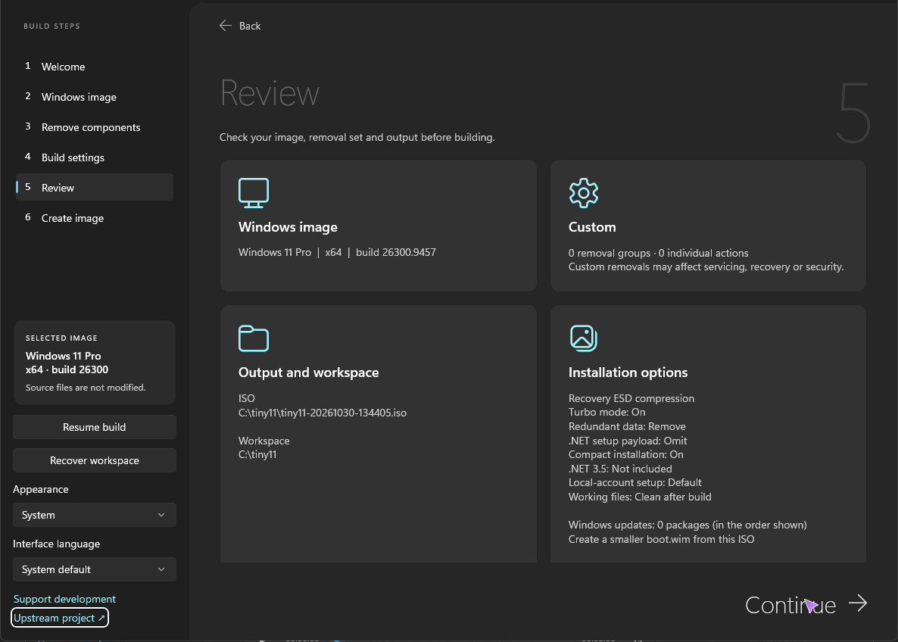

# Tiny11 Builder

**Build a smaller Windows 11 installer. Choose what stays.**

Start with an official Microsoft image or your own ISO, choose the apps and
features you want, and create your installer in a native Windows app.
Your original source media is left unchanged.

[**Download for Windows**](https://github.com/ntdevlabs/tiny11builder/releases/latest) ·
[What's new in 0.2.0](docs/release-notes-0.2.0.md) ·
[Watch the 0.2.0 demo](https://youtu.be/Ijp3J8SYqLc) ·
[Get help or report a problem](https://github.com/ntdevlabs/tiny11builder/issues)

## Get started

1. **Download and extract the whole ZIP.** Choose **x64** for Intel/AMD PCs or
   **ARM64** for Windows on ARM.
2. **Open `Tiny11Builder.exe`.** Approve the administrator prompt.
3. **Choose your Windows image and what to keep.** Download an official image
   in the app or select your own, review your choices, then build your ISO.

The app includes its .NET runtime. For image-tool requirements and a full
walkthrough, see the [usage guide](docs/usage.md).

## Pick a starting point

| Choose | When it fits |
| --- | --- |
| **Tiny11** | A leaner image that keeps Windows Update, Defender and recovery. |
| **Custom** | Choose removals yourself, or load a recipe and adjust it to your needs. |
| **Tiny11 Core** | Disposable test VMs. Removes update and recovery support and disables Defender. |

> **Try your image in a virtual machine first.** Core cannot be updated or
> serviced. Advanced Custom removals can break Windows, apps or devices.

## More control in 0.2.0

- **Reuse a setup you like.** Load a recipe, review its selected removals,
  and adapt it to another Windows image.
- **Know what will change.** Browse the Tiny11 and Core removal plans, or
  export a complete list of components for a closer look.
- **Bring updates along.** Add local Windows update packages before building,
  in the order your image needs.
- **Use your language.** English and Simplified Chinese are included.
  Additional languages can use [translation files](docs/translation.md).
- **Go further with Custom.** Fine-tune individual removals and create a
  smaller installer from your own Windows image.

Turbo mode speeds up processing. Interrupted builds can resume once a saved
image checkpoint is available.

[Read the full 0.2.0 release notes](docs/release-notes-0.2.0.md)

## Watch what's new

## A look inside

| See what a preset removes | Check your build before starting |
| --- | --- |
|  |  |

## Compatibility and advanced use

Windows 11 images from **22H2 onward** are supported. Insider and Canary builds
need compatible Microsoft image tools; Windows Server is not supported.
See [requirements and compatibility](docs/usage.md) before choosing a source.

Looking for deeper customization or a very small image?

Custom includes individual app, component, service, file, driver and font
removals, plus optional installer cleanup.

The bundled [extreme recipe](recipes/cd700-custom.json) is a starting point
for experimenting with much smaller images, not another build mode.
CD size is an optional target, not a guarantee for every Windows image.
Test the result in an isolated virtual machine.

See the [usage guide](docs/usage.md) for the controls and their tradeoffs.

## Help keep the next update coming

Tiny11 Builder grows through testing and feedback from people using it.
If it saves you time, a contribution helps fund development, testing across
Windows releases, and fixes for real-world problems.

**[Sponsor monthly](https://github.com/sponsors/ntdevlabs)** ·
**[Send a one-time thanks](https://ko-fi.com/ntdev)**

You can also use [Patreon](https://www.patreon.com/ntdev) or
[PayPal](https://paypal.me/ntdev2).

**Every feature is free, whether you donate or not.** Clear bug reports,
testing in a VM, and sharing the [demo](https://youtu.be/Ijp3J8SYqLc) help too.

---

[Usage and build instructions](docs/usage.md) ·
[Translation guide](docs/translation.md) ·
[Attribution and distribution notices](NOTICE.md)

The original PowerShell builders remain in this repository.
